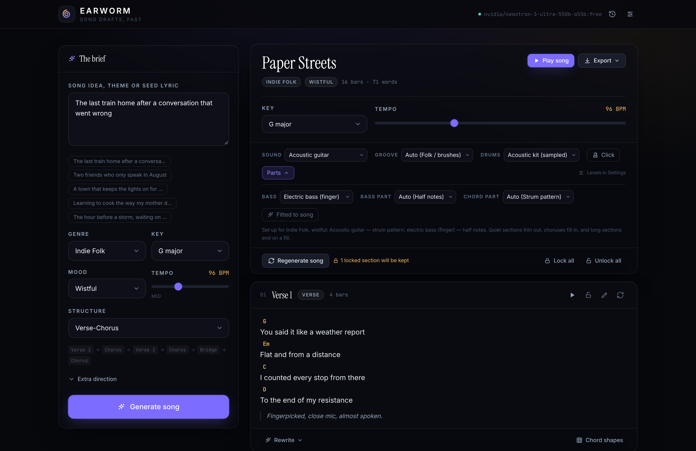
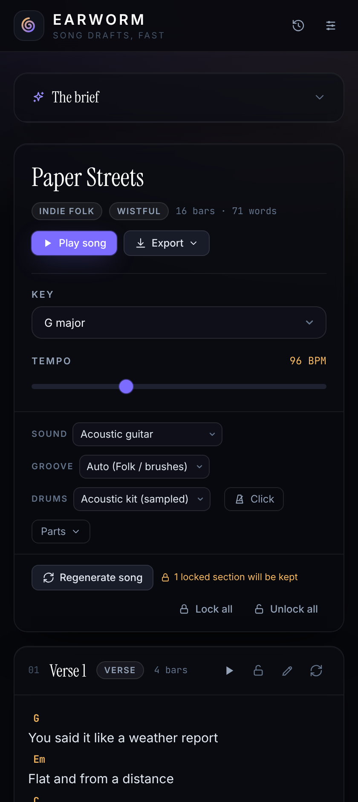

<div align="center">


# EARWORM

### An idea in. A song out.

**Turn one line into a finished song draft — lyrics, chords, a singable melody, and a band to play it back. Runs in your browser, on free models.**

[](https://galvinlam.github.io/earworm/)
[](https://github.com/galvinlam/earworm/actions/workflows/test.yml)
[](LICENSE)
[](#put-it-on-your-phone)

**[Try it live](https://galvinlam.github.io/earworm/)** · [Quick start](#quick-start) · [Features](#what-you-get) · [Free models](docs/PROVIDERS.md) · [How it works](docs/ARCHITECTURE.md)



</div>

---

## Songwriters get a blank page. You get a draft.

An earworm is the bit of a song you cannot shake. This is a tool for writing one.

Type *"the last train home after a conversation that went wrong"* and Earworm hands back a complete song: verses and a chorus, a chord progression that actually resolves, a singable melody line, and a rhythm section playing it in your browser.

Then you work. Lock the chorus that landed, rewrite the verse that didn't, nudge a chord, make the bridge darker — and export the whole thing as MIDI into your DAW.

It runs entirely in your browser. Your API key and your lyrics never leave your machine, because there is no server to send them to.

## What you get

🎵 **A real arrangement, not a wall of text** — every section carries chords per bar and a melody contour, voice-led so progressions move the way a player would rather than lurching around the keyboard.

🎧 **Press play, hear a band** — recorded piano, electric piano, four guitars and three basses (sampled, not synthesized), nine grooves from jazz shuffle to reggae one-drop, a real drum kit and a metronome.

🎚️ **Parts that fit the song** — Auto picks the bass line and the guitar part from the genre and the mood, intros play sparse and choruses fill in, and long sections end on a fill. Or take over: walking bass, pumping eighths, a strum pattern, offbeat stabs, an arpeggio.

🔒 **Lock what works** — regenerate the whole song and your favourite chorus survives untouched.

✏️ **Rewrite by the line** — *make it more anthemic*, *darker*, *more conversational*, *shorten*. Or edit the lyrics and chords by hand.

💾 **Take it with you** — Markdown, a plain-text chord chart, a **WAV of exactly what you heard**, or a 5-track MIDI file with each track set to its matching General MIDI instrument.

🆓 **Free to run** — ships configured for free models, with a `:free` filter in the model picker and automatic recovery when a small model mangles its JSON.

📱 **Installs on your phone** — add it to the home screen and it runs full-screen like an app. Drafts, playback and export work with no signal; only generating needs a connection.

🎸 **Guitar shapes, version history, shareable links** — the whole song travels inside the URL, so nothing is ever uploaded.

<div align="center">

<p><em>Writes on a phone too — the brief collapses, the song stays readable.</em></p>
</div>

## Quick start

Needs [Node.js](https://nodejs.org) 20.19 or later.

```bash
git clone https://github.com/galvinlam/earworm.git
cd earworm
npm install
npm run dev
```

Open http://localhost:5173, click the settings icon, paste an API key, press **Test**.

That's it. Earworm comes pointed at [OpenRouter](https://openrouter.ai), whose free models cost nothing and work straight from the browser — the model picker hides anything that isn't free until you say otherwise.

> **Want Nemotron, Gemini, Groq or a local Ollama model instead?** All supported. NVIDIA blocks browser requests, so a proxy ships with the project — see [docs/PROVIDERS.md](docs/PROVIDERS.md).

## Put it on your phone

Earworm is a PWA, so there is no app store and no build step — deploy it, open the
URL on your phone, and add it to the home screen.

| Phone | How |
|---|---|
| **iPhone / iPad** | Open in **Safari** (not Chrome) → Share → **Add to Home Screen** |
| **Android** | Open in Chrome → the **Install app** prompt, or ⋮ → **Install app** |

It then runs full-screen with its own icon, and because the app shell and the
instrument samples are cached, it opens and plays without a connection. (Each
recorded instrument is fetched the first time you pick it, a few hundred KB; until
then it plays a synthesized stand-in.)

**What works offline:** opening the app, every saved draft, editing, playback,
chord shapes, Markdown/text/MIDI export.
**What does not:** generating and rewriting — those need the model API. The app
shows an *Offline* badge and says so rather than failing at you.

Two things worth knowing about iOS: there is no install prompt, so it has to be the
Share menu, and iOS can evict a PWA's storage if the device is low on space and the
app goes unused for weeks — so export anything you would hate to lose.

## Deploy it

Static output, so anywhere works.

| Host | What to do |
|---|---|
| **Vercel / Netlify** | Connect the repo. Config files are already here. |
| **GitHub Pages** | Push to `main`, then Settings → Pages → Source → GitHub Actions. The included workflow handles the rest. |
| **Anywhere** | `npm run build`, serve `dist/`. |

Installing requires HTTPS. All three hosts above provide it; `localhost` counts too,
so you can test the install flow before deploying.

Each visitor brings their own API key, stored in their own browser. Never put a real key in `.env` for a site you publish — Vite bakes those into the bundle.

## Built with

React · Vite · Tailwind · Zustand · Tone.js · zero backend

## Testing

```bash
npm run smoke
```

146 checks in under a minute: the real app in jsdom, the network client against
a mock provider, the audio scheduler against a recording Tone stub, the CORS proxy over
real sockets, and the installed app in headless Chromium — including a cold load with
the network switched off, and real offline audio renders — sampled, stand-in and
drum kit — decoded and measured for level, clipping and silence.

The browser checks need Playwright, which is deliberately *not* a dependency (it is a
~300 MB install). Without it those checks report as skipped rather than failing. CI
installs it, so every push runs the full suite. The tests need Node 22.

## Honest about the limits

- **Playback is a sketch, not a production.** Real samples and parts that follow the song, but still patterns — a session band reading a chart. It tells you whether a progression and a feel work. For anything you'd play to a person, export the MIDI and use real instruments.
- **Exported MIDI sounds like whatever plays it.** Double-clicked on Windows it gets the 1990s General MIDI synth built into the OS. Open it in GarageBand, Logic or any DAW for proper instruments — or export WAV, which is the sound you heard in the app.
- **The melody is a contour.** A shape to sing against, not a finished topline.
- **Free models write weaker lyrics.** The JSON repair layer makes their output *parseable*, not *good*. `gpt-4o-mini` costs a few cents a song and is noticeably better.
- **It writes drafts.** That's the point of the locks and the rewrites — the first result is a starting position, not an answer.

## Docs

- [Providers, free models and CORS](docs/PROVIDERS.md) — every provider, free tiers, the proxy
- [How it works](docs/ARCHITECTURE.md) — the schema, voice leading, grooves, samples, project structure
- [Contributing](CONTRIBUTING.md) — where things live and how to run the checks

## Brand assets

Logo, favicon, social card and the in-app `<Logo>` component all come from one
source:

```bash
node brand/build.mjs
```

Edit `brand/marks.mjs`, re-run, and everything updates together — so the mark in
the app header can never drift from the one in this README.

| Output | Where it goes |
|---|---|
| `public/icon.svg` | favicon |
| `public/og-image.png` | social preview, ships with the build |
| `brand/logo-mark.svg`, `brand/logo-lockup.svg` | docs and slides |
| `src/components/Logo.jsx` | the app header |

## Credits

Built by **Galvin Lam**.

Sounds, fetched by your browser at play time rather than shipped in this repo:

- Guitars, basses and electric piano — the **Musyng Kite** soundfont, pre-rendered by
  [gleitz/midi-js-soundfonts](https://github.com/gleitz/midi-js-soundfonts),
  [CC BY-SA 3.0](https://creativecommons.org/licenses/by-sa/3.0/)
- Piano — **Salamander Grand Piano** by Alexander Holm,
  [CC BY 3.0](https://creativecommons.org/licenses/by/3.0/), via the
  [Tone.js audio](https://github.com/Tonejs/audio) repository
- Acoustic drum kit — from the [Tone.js audio](https://github.com/Tonejs/audio) repository

## Licence

MIT — use it, fork it, strip it for parts. The MIT licence covers the code; the
samples above keep their own licences.
